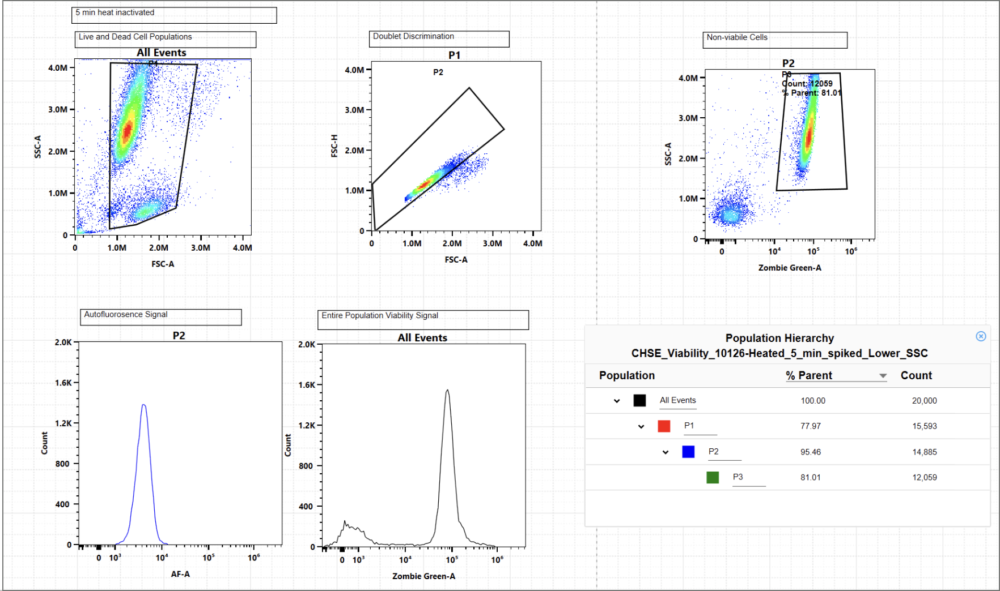

# 6PPD-q exposure and CSE-119 viability 
2026-10-14

https://github.com/lindensm2/tfcb_2026_demo/issues/1

## Reagents
| reagent | vendor | catalog number | stock concentration | final concentration |
| ------- | ------ | -------------- | ------------------- | ------------------- |
| 6PPD-q  | HPC    | XXXXXXXXXXXXXX |     2.98x10^6       |     200, 100, 10    |
| Zombie Green | Biolegend | XXXXX | XXXXX | 1:1000 |
| DMSO | XXX | XXXX | 100% | 200 ug/L |
| Antimycin A | Thermo Fisher | XXXX | 10 mM | 200 ug/L |

## Procedure
- Plate CSE-119 into 6 well plates at 300,000 cells per well
- Prepare dosing solutions in L15 Media
- After 24 hours, expose 3 wells to 6PPD-q (200ug/L, 100 ug/L, and 10 ug/L), expose 1 well to Antimycin A (200 ug/L), Expose 1 well to DMSO (200 ug/L), and replace media for unstained
- Collect unadhered and adhered cells and from wells and pellet in centrifuge. Use trypsin for detaching.
- Wash cells with 1 mL PBS then resuspend in 200uL of Zombie Green Viability Dye at 1:1000 in PBS
- Wash cells with 1 mL L15 media then resuspend in 300 uL L15 media and transfer to FACS tube before analyzing via flow cytometry

## Result

Example of previous flow but related flow gating strategy (current experiment has not been completed), this data was produced by Linden McHenry.

PROBLEM 3
I has already completed all my edits before reading problem 3 so I am doing my commits with the #1 here
